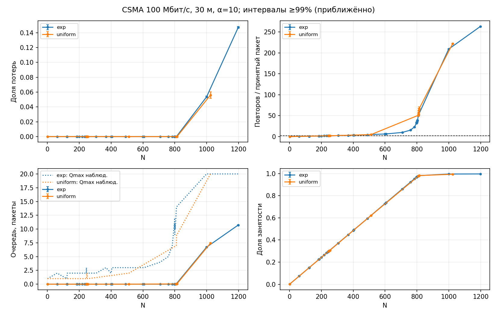
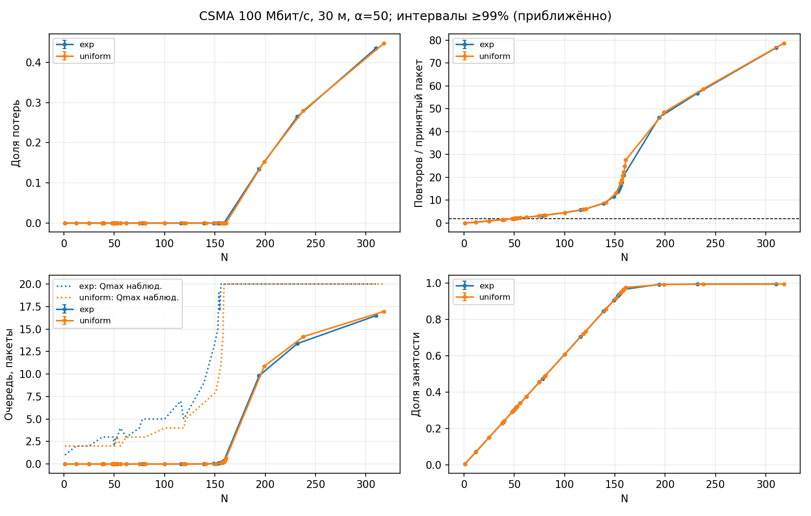
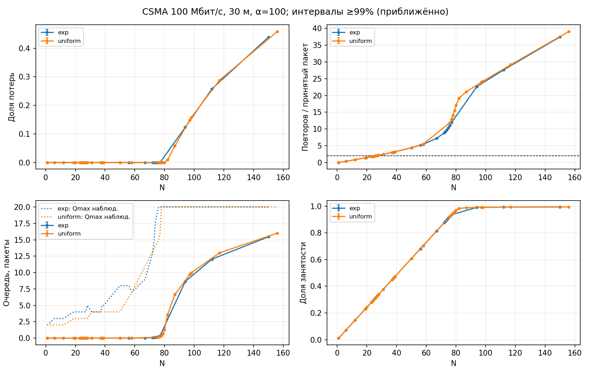

# Исследование общего CSMA-канала, задание 3, вариант 3

**Завершено, 07.11.2026:** использована ns-3.49, модель собрана без ошибок.
Сохранены 18 432 реальных прогона и результаты всех шести режимов:
165 измерительных точек, таблицы и три графика. Накопленные 17 920 прогонов
сохранены; ограниченное завершение добавило ровно 512 новых прогонов.
Часть оценок не достигла точности ±5%, а порог повторов при α=10 остаётся
статистически неопределённым. Максимумы без наблюдаемых потерь относятся
только к исследованным N и указанным выборкам.

## Цель и постановка

Исследовать влияние числа станций N на потери, число повторных попыток доступа,
очереди адаптеров и занятость общей среды. Найти две границы для каждого
α=10,50,100 пакетов/с и каждого закона интервалов: Exp(среднее 1/α)
и U(0,2/α).

Параметры взяты из задания, слайды 6–9: общий канал 100 Мбит/с,
длина 30 м, пакет генератора 1500 байт, интервал наблюдения 10 с,
очередь каждого адаптера 20 пакетов. Использованы стандартные
`CsmaHelper`, `CsmaNetDevice`, `DropTailQueue`, генераторы ns-3 и
событийное планирование из лекции по ns-3. Коллизии не моделируются.

Генерация очередного пакета не зависит от передачи предыдущего.
Размер Ethernet-кадра после DIX-инкапсуляции — 1518 байт;
задержка распространения — 150 нс при принятой скорости 2·10⁸ м/с.
При N=1 измеряется только обслуживание передатчиком; при N≥2
пакет адресуется следующему узлу. Служебного и ответного трафика нет.

## Измерение и план экспериментов

Счётчик созданных пакетов увеличивается до вызова отправки. Переполнения
очереди считаются один раз; отдельный счётчик учитывает сбросы при
обслуживании. После прекращения генерации в t=10 сеть дорабатывает
пакеты до конечного исхода. Остаток на границе не приравнивается к потере.
Проверяется баланс «создано = потеряно + передано».

Среднее число повторов — число событий `MacTxBackoff`, делённое на
число принятых адаптерами пакетов, включая пакеты с нулём повторов
и возможные сбросы после исчерпания повторов. Средняя очередь —
интеграл числа ожидающих пакетов за 0–10 с, усреднённый по N адаптерам.
Максимальная очередь — наблюдаемый максимум по времени, узлам и прогонам;
текущий обслуживаемый пакет в длину очереди не входит.
Занятость — доля 0–10 с в состояниях передачи и распространения,
без ожидания backoff и межкадровых пауз.

Поисковые прогоны использовались для выбора диапазона N; средние и ДИ
рассчитываются по отдельным измерительным сериям. Начальное состояние —
пустые очереди, окно 10 с без прогрева. Монотонность проверяется только
в исследованных точках; случайные нарушения не означают ошибки модели.

В сохранённых данных 904 поисковых и 17 528 измерительных прогонов.
При ограниченном завершении использовано по 4 поисковых и обычно
32 измерительных прогона на необходимую точку; в опорных точках графика —
по 8. Заполнен пробел N=248 для Exp, α=10. Остальные накопленные прогоны
использованы повторно как данные, без повторного моделирования.
Дополнительный бюджет составил 512 прогонов и полностью соблюдён.

Для итоговых ДИ использована консервативная поправка на пять средних и пять
возможных объёмов выборки: 8, 16, 32, 64, 128. Хвост для каждого интервала
равен 0,01/25=0,0004; индивидуальный уровень — 99,96%, приближённое совместное
покрытие для фиксированного N — не ниже 99%. Это t/ЦПТ-аппроксимация,
особенно ограниченная для редких событий и малых выборок. Совместная гарантия
для всех адаптивно выбранных N не утверждается.

Точность ±5% проверяется для ненулевых средних потерь, повторов, средней
очереди и занятости. Наблюдаемый максимум очереди выводится отдельно;
среднее максимумов не является дополнительным требованием задания.
Статусы точности сохранены без округления или замены отсутствующих ДИ
нулевыми интервалами.

## Сборка и воспроизводимость

Среда: WSL2, Ubuntu 24.04.4, GCC 13.3.0, Python 3.12.3,
SciPy 1.11.4, Matplotlib 3.6.3. Установленная ns-3.49 найдена в
`/home/vova/ns-3`, хотя команды `ns3` в PATH нет. Ошибок компиляции модели
не обнаружено; переписывать `csma-v3.cc` не потребовалось.

Для ускорения серий из уже имеющегося архива собраны оптимизированные
библиотеки ns-3.49 в `/tmp`; исходники установленной версии не изменялись.
Контрольные прогоны с N=1, 10 и 50 совпали с установленной сборкой.
Ни загрузка из сети, ни установка новых Python-пакетов не потребовались.
Команды из каталога задания:

```bash
mkdir -p /tmp/hw3-ns3
tar -xjf /home/vova/ns-3.49.tar.bz2 -C /tmp/hw3-ns3
NS3_HW3=/tmp/hw3-ns3/ns-3.49
cmake -S "$NS3_HW3" -B "$NS3_HW3/cmake-cache" -G Ninja \
  -DCMAKE_BUILD_TYPE=Release -DNS3_ENABLED_MODULES=csma \
  -DNS3_ASSERT=OFF -DNS3_LOG=OFF -DNS3_NATIVE_OPTIMIZATIONS=ON \
  -DNS3_EXAMPLES=OFF -DNS3_TESTS=OFF -DNS3_PRECOMPILE_HEADERS=OFF \
  -DNS3_WARNINGS_AS_ERRORS=OFF -DNS3_GSL=OFF -DNS3_SQLITE=OFF -DNS3_EIGEN=OFF
cmake --build "$NS3_HW3/cmake-cache" --target csma -j 8
mkdir -p "$NS3_HW3/build/scratch"
g++ -std=c++23 -O3 -march=native -Wall -Wextra \
  -isystem "$NS3_HW3/build/include" csma-v3.cc \
  -L"$NS3_HW3/build/lib" -Wl,-rpath,"$NS3_HW3/build/lib" \
  -lns3.49-csma-optimized -lns3.49-network-optimized -lns3.49-core-optimized \
  -o "$NS3_HW3/build/scratch/csma-v3"
```

`/tmp` — временный каталог. Повторный запуск при сохранённой сборке использует
записанные прогоны. Идентичность модели, бинарного файла, версии и seed
фиксируется первой строкой `results/raw.jsonl`; другой бинарный файл или seed обнаруживаются при чтении кэша.
Серии выполнены через `experiments.py`; ограниченное завершение использовало
его `Study.sample`, расчёт статистики и штатную запись CSV/графиков с тем же
исполняемым файлом и теми же правилами seed/run. Параметры каждого прогона
сохранены в [raw.jsonl](results/raw.jsonl). Это позволяет воспроизвести отдельный
прогон по его n, alpha, dist, seed и run; для чтения отчёта повторный запуск
серий не требуется.

Параметр `--jobs` меняет только число одновременно работающих процессов;
seed/run и порядок записей не меняются. В проекте сохранены два исходника,
отчёт и штатные результаты скрипта, без новых компонентов.

## Результаты

Выполнены **6 из 6** обязательных режимов. Все числа получены реальным моделированием ns-3.49.

Первый эксперимент: ниже указано наибольшее N без наблюдаемых потерь **среди исследованных N**. В колонке «все записи» объединены счётчики поисковых и измерительных прогонов одного N; отдельно показан максимум измерительных серий. Поисковые данные не включены в средние и ДИ последующих таблиц. Нулевая выборка не доказывает нулевую вероятность потерь или глобальный максимум.

| α, пакетов/с | Закон | N максимум, все записи | Прогоны | Фазы при этом N | N максимум, измерительные | Измерительных прогонов | Согласованность измерений |
|---:|---|---:|---:|---|---:|---:|---|
| 10 | exp | 808 | 8 | pilot: 8 | 801 | 128 | случайная немонотонность |
| 10 | uniform | 812 | 4 | pilot: 4 | 810 | 32 | немонотонность не обнаружена |
| 50 | exp | 158 | 8 | pilot: 8 | 155 | 128 | немонотонность не обнаружена |
| 50 | uniform | 159 | 128 | measure: 128 | 159 | 128 | немонотонность не обнаружена |
| 100 | exp | 75 | 128 | measure: 128 | 75 | 128 | немонотонность не обнаружена |
| 100 | uniform | 78 | 136 | pilot: 8, measure: 128 | 78 | 128 | немонотонность не обнаружена |

Различные объёмы выборок не позволяют считать различие этих максимумов доказанным преимуществом одного распределения. В частности, точка только с 4–8 поисковыми прогонами имеет существенно меньшую статистическую опору, чем точка со 128 измерительными прогонами. Случайная немонотонность наблюдений не означает ошибки модели.


Немонотонность при α=10, exp: N=800 — 1 потеря за 128 прогонов; большее N=801 — ноль потерь за 128 прогонов. Среди измерительных точек наибольшее N без наблюдаемых потерь — 801. Это случайная немонотонность конечных наблюдений, а не ошибка модели; глобальный максимум не установлен.

Второй эксперимент: N в таблице — наибольшее исследованное N со средним числом повторов по измерительным прогонам ≤2. Это выборочная оценка. Для подтверждения порога по ДИ его верхняя граница при N должна быть ≤2, а нижняя при N+1 — >2. При статусе uncertain N справа может отличаться от N+1; тогда максимум не установлен. Максимум очереди — максимум по узлам, времени и выполненным прогонам данного N.

| α | Закон | Оценка N при повторах ≤2 | R | Повторы при N: среднее ± h | N справа | R справа | Повторы справа: среднее ± h | Qmax при N | Статус |
|---:|---|---:|---:|---|---:|---:|---|---:|---|
| 10 | exp | 247 | 128 | 1.99282 ± 0.0081 | 248 | 32 | 2.00793 ± 0.018 | 2 | uncertain |
| 10 | uniform | 247 | 32 | 1.99207 ± 0.018 | 248 | 32 | 2.00364 ± 0.016 | 2 | uncertain |
| 50 | exp | 50 | 128 | 1.98003 ± 0.008 | 51 | 128 | 2.02223 ± 0.0074 | 2 | adjacent_checked |
| 50 | uniform | 50 | 128 | 1.97917 ± 0.0075 | 51 | 128 | 2.0236 ± 0.0073 | 2 | precision_not_met |
| 100 | exp | 25 | 128 | 1.92559 ± 0.0076 | 26 | 128 | 2.01466 ± 0.0074 | 4 | adjacent_checked |
| 100 | uniform | 25 | 128 | 1.93108 ± 0.0067 | 26 | 128 | 2.01968 ± 0.0064 | 3 | adjacent_checked |

При α=10, exp точный порог по ДИ не разделён: при N=246 верхняя граница ≤2, при N=249 нижняя граница >2. Между ними остаётся статистическая неопределённость. В таблице выше приведена выборочная оценка, а не доказанный максимум.

При α=10, uniform точный порог по ДИ не разделён: при N=246 верхняя граница ≤2, при N=250 нижняя граница >2. Между ними остаётся статистическая неопределённость. В таблице выше приведена выборочная оценка, а не доказанный максимум.

### Четыре характеристики в выбранных измерительных точках

Для критерия потерь характеристики здесь относятся к максимуму измерительных точек, без смешивания с поисковой фазой. Здесь h — полуширина интервала, рассчитанная по независимым прогонам. Для нулевых выборок численный ДИ не оценивается. Занятость показана в процентах.

| α | Закон | Критерий | N | R | Доля потерь ± h | Повторы ± h | Qср ± h, пакеты | Qmax наблюд. | Занятость ± h, % | ±5% для средних |
|---:|---|---|---:|---:|---|---|---|---:|---|---|
| 10 | exp | потери | 801 | 128 | 0 (не наблюдалось) | 36.416 ± 1.4 | 0.0356465 ± 0.0038 | 11 | 97.2116 ± 0.11 | НЕТ |
| 10 | exp | повторы | 247 | 128 | 0 (не наблюдалось) | 1.99282 ± 0.0081 | 3.67532e-06 ± 3.6e-07 | 2 | 30.0337 ± 0.055 | НЕТ |
| 10 | uniform | потери | 810 | 32 | 0 (не наблюдалось) | 53.8397 ± 2.9 | 0.0470266 ± 0.0075 | 8 | 97.8246 ± 0.1 | НЕТ |
| 10 | uniform | повторы | 247 | 32 | 0 (не наблюдалось) | 1.99207 ± 0.018 | 2.01043e-06 ± 6e-07 | 2 | 29.9507 ± 0.078 | НЕТ |
| 50 | exp | потери | 155 | 128 | 0 (не наблюдалось) | 15.5373 ± 0.17 | 0.137144 ± 0.0064 | 17 | 94.1672 ± 0.11 | да |
| 50 | exp | повторы | 50 | 128 | 0 (не наблюдалось) | 1.98003 ± 0.008 | 9.12833e-05 ± 4.1e-06 | 2 | 30.4111 ± 0.057 | да |
| 50 | uniform | потери | 159 | 128 | 0 (не наблюдалось) | 22.4374 ± 0.2 | 0.255769 ± 0.01 | 20 | 96.4267 ± 0.058 | да |
| 50 | uniform | повторы | 50 | 128 | 0 (не наблюдалось) | 1.97917 ± 0.0075 | 4.49872e-05 ± 2.6e-06 | 2 | 30.3758 ± 0.037 | НЕТ |
| 100 | exp | потери | 75 | 128 | 0 (не наблюдалось) | 10.4017 ± 0.053 | 0.193483 ± 0.0056 | 19 | 91.1898 ± 0.1 | да |
| 100 | exp | повторы | 25 | 128 | 0 (не наблюдалось) | 1.92559 ± 0.0076 | 0.000354149 ± 1.2e-05 | 4 | 30.3733 ± 0.055 | да |
| 100 | uniform | потери | 78 | 128 | 0 (не наблюдалось) | 14.0902 ± 0.061 | 0.380976 ± 0.01 | 20 | 94.6981 ± 0.06 | да |
| 100 | uniform | повторы | 25 | 128 | 0 (не наблюдалось) | 1.93108 ± 0.0067 | 0.00016915 ± 6.6e-06 | 3 | 30.3795 ± 0.034 | да |

### Точность и ограничения

`adjacent_checked` означает проверенную соседнюю границу при принятой монотонности. `precision_not_met` означает, что хотя соседние N проверены, хотя бы одно требуемое ненулевое среднее при N или N+1 не достигло ±5%. `uncertain` означает пересечение ДИ с порогом 2; `nonmonotone_observed` запрещает объявлять результат двоичного поиска максимумом.

Для первого эксперимента даже единичная потеря при N+1 подтверждает наличие потерь в этой серии, но не даёт точной оценки их вероятности. Поэтому эмпирическую пару N/N+1 следует отличать от результата со всеми выполненными требованиями точности. Нулевые выборки не получают фиктивного ДИ [0,0].

Точность ±5% проверяется для доли потерь, повторов, средней очереди и занятости. В исходном сценарии дополнительно требовалась точность среднего максимума очереди; это условие снято, поскольку задание требует наблюдаемый максимум. Сам Qmax и диагностическое среднее максимумов сохранены. Поправка Бонферрони на пять средних остаётся консервативной; покрытие приближённое для фиксированного N и не гарантирует совместного покрытия всех адаптивно выбранных N.

Всего в текущей сводке 165 точек; для 78 точек точность средних не достигнута. Это ограничение конечной серии, а не основание приписывать ей большую точность. Подробные интервалы, относительные полуширины и числа повторений: [summary.csv](results/summary.csv); все точки: [results.md](results/results.md).

### Графики







На графиках нулевые выборки показаны точками без оценённого ДИ; пунктир Qmax показывает наблюдаемый максимум, а не среднее максимумов.

## Проверка корректности

Проверены все 18 432 реальных прогона, включая поисковые: баланс пакетов, совпадение причин потерь, число принятых пакетов, предел очереди 20, допустимый остаток обслуживания в t=10 и отсутствие повторяющихся seed/run в одной серии. Занятость сверена с числом завершённых передач и длительностью кадра: (1518·8/100000000 + 150·10⁻⁹) с = 121,59 мкс. Разница на границе окна не превышает одного кадра.

Средние, стандартные отклонения, интервалы Стьюдента, нулевые выборки и флаги
точности всех 165 точек дополнительно пересчитаны и сверены с `summary.csv`.
Проверены совпадение хешей модели/бинарного файла с метаданными и сохранение
17 920 исходных записей: 512 новых записей относятся только к недостающей
точке Exp и ограниченному завершению U при α=10.

Контрольные прогоны на исходной установленной и оптимизированной сборках совпали. C++-модель дополнительно проверяет совпадение трасс очереди и MAC, отсутствие перекрытия передач и полную доработку созданной когорты. Счётчики потерь и повторов относятся ко всей созданной когорте; очередь и занятость измеряются только в [0,10).

Пример причины потерь: при α=10, Exp, N=810 за 128 прогонов зарегистрировано 0 сбросов очереди и 28 `PhyTxDrop`; Qmax=14. В стандартной модели такие сбросы возникают после исчерпания лимита 1000 повторных попыток. Заполненная очередь — не единственная возможная причина потери.

## Выводы

- При α=10 наибольшие исследованные N без наблюдаемых потерь (все записи): Exp — 808, U — 812; выборочные оценки по повторам — 247 и 247. Объёмы выборок и статусы приведены выше.
- При α=50 наибольшие исследованные N без наблюдаемых потерь (все записи): Exp — 158, U — 159; выборочные оценки по повторам — 50 и 50. Объёмы выборок и статусы приведены выше.
- При α=100 наибольшие исследованные N без наблюдаемых потерь (все записи): Exp — 75, U — 78; выборочные оценки по повторам — 25 и 25. Объёмы выборок и статусы приведены выше.
- При выборочных оценках порога повторов наблюдаемый Qmax равен 2 пакетам для α=10 и α=50 у обоих законов; для α=100 — 4 у Exp и 3 у U. Занятость в этих точках около 30%, то есть ограничение по повторам достигается значительно раньше насыщения канала.
- При α=10 по ДИ подтверждена допустимость N=246; недопустимость подтверждена с N=249 для Exp и с N=250 для U. Выборочная оценка 247 не устраняет неопределённость внутри этих диапазонов.
- Увеличение N повышает число откладываний доступа и очередь; при перегрузке занятость приближается к единице, а потери растут. Коллизии для этого не нужны: доступ откладывается из-за занятого канала.
- Отсутствие наблюдаемых потерь, достижение Qmax=20 и статистическая точность — разные условия. Потери нужно считать по конечным исходам пакетов, сохраняя остаток в t=10 отдельно.
- Окончательный вывод о выполнении требований ±5% следует делать по флагам и интервалам, а не по округлённым средним или гладкости графиков.

## Короткая презентация: четыре слайда

1. **Задача и схема:** N узлов — один CSMA-канал; параметры;
   два закона поступления; две искомые границы.
2. **Модель и достоверность:** независимая генерация, очередь 20,
   трассы ns-3, доработка остатка, баланс пакетов; 99%-е ДИ и ±5%.
3. **Результаты:** максимумы среди исследованных N, оценки порога повторов,
   графики зависимости от N; отдельно отметить неполные/неопределённые оценки.
4. **Выводы:** выборочные оценки и Qmax, случайная немонотонность, ограничения ДИ;
   отсутствие наблюдаемых потерь не равно доказанной нулевой вероятности.

Источники: приложенные `lecture_zadanie3(1) (1).pdf` и `lecture_ns3.pdf`;
исходники проверенной ns-3.49:
[CsmaNetDevice](/home/vova/ns-3/src/csma/model/csma-net-device.cc:451),
[Backoff](/home/vova/ns-3/src/csma/model/backoff.cc:20).
